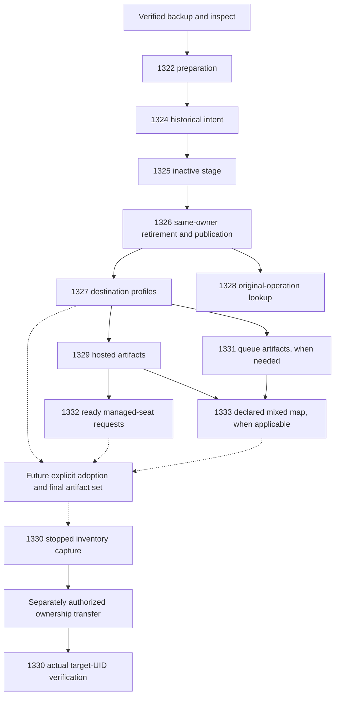

# Retained board relocation toolkit

This catalogs the history-preserving toolkit shipped through release 486
(`67a081040e0a9d64247aef5c1a9054f7628bd627`), not an executable move procedure.
Its source, isolated fixtures, applied faults/restorations and independent
reviews are retained. It has **not** been rehearsed end to end under another
real account or used to move this board. Cold artifacts do not install
themselves, and the remaining adoption work is not built.

The selected next direction is a fresh independent board with selected context
as new records (1337). This toolkit is retained for a future move that needs
original history; it is not a prerequisite for that fresh installation.
The optional real-board inactive half-chain exercise (1339) is deferred, not
authorized or required to archive the existing fixture proof.

Use the [supplied-path contract](runtime-roots.md) and current sourced rules.
This document selects no instance, account, command invocation or maintenance
run. The contracts below, rather than an old runbook draft, define each API.

## Dependencies and supported boundaries

The following is a dependency map, not permission to execute the chain.
Each nested request, raw manifest, digest, original operation and observation
retains its exact recorded identity.



1328 is an optional read after confirmed publication, not a retry adapter.
1331 is a sibling of 1329 and does not consume hosted output. 1332 consumes
1329, not 1331 or 1333. 1333 requires genuinely nonempty hosted **and** queue
partitions within one declared profile universe; do not invent queue actors
to use it for an all-hosted board. Its declared coverage is not an inventory
of every actor or a certificate that a route can start.

| Step and source | Operator API and explicit input | Result and limit; exact contract |
| --- | --- | --- |
| Backup, [recovery.py](../aim_next/recovery.py) | `backup(db_path, instance_id, *, expected_binding, bundle_path)` then `inspect(bundle_path, *, expected_digest=None)` | Verified DB/media bundle and digest; pin the expected digest explicitly for relocation. Later source writes require fresh input. [Recovery API](recovery-api.md) |
| 1322, [relocation.py](../aim_next/relocation.py) | `prepare(value)`, `inspect_prepared(value)`; exact move/source/destination/UID/commit request and verified bundle | Independent inactive preparation; no metadata change, epoch, authority or usable binding. The source DB path is a caller-pinned assertion, not a verified live path. [Preparation](authority-root-relocation.md) |
| 1324, [relocation_publication.py](../aim_next/relocation_publication.py) | `prepare_publication_intent(request)`, `inspect_publication_intent(request)`; exact 1322 request and private journal root | Historical source observation, including actual DB path/inode, authority and both commit fields. Authority SH is not quiescence or a lease; recheck later. [Intent](authority-publication-intent.md) |
| 1325, [relocation_stage.py](../aim_next/relocation_stage.py) | `stage_relocation(request)`, `inspect_relocation_stage(request)`; exact intent/digest and separate journal | Same-UID independent destination, one persisted epoch, only `authority_path`/`authority_epoch` metadata changes, actual three identity pairs. No anchor or binding. An appearing destination anchor refuses staging retry. [Stage](authority-relocation-stage.md) |
| 1326, [relocation_cutover.py](../aim_next/relocation_cutover.py) | `publish_relocation(request)`, `relocation_readback(request)`; exact stage/digest and separate journal, same actual UID | Exclusive fresh predecessor/commit/identity checks; durable source retirement before destination publication. Only confirmed `published` returns a binding; no profile or consumer is installed. [Retirement/publication](authority-retirement-publication.md) |
| 1327, [destination_profiles.py](../aim_next/destination_profiles.py) | `stage_destination_profiles(store, publication_receipt, request)`, `inspect_destination_profiles(request)`; current Store, confirmed 1326, exact historical profile snapshots | Exclusive private profiles, empty outboxes and final manifest for enabled actors; neither selection nor adoption. [Profiles](destination-profile-staging.md) |
| 1328, [relocation_operations.py](../aim_next/relocation_operations.py) | `lookup_relocated_operation(store, actor, saved_request, publication_receipt)` | Same enabled actor, current immediate lineage and ORIGINAL envelope fingerprint; unchanged recorded outcome or `unknown_held`, with no replay. [Operation lookup](relocated-operation-lookup.md) |
| 1329, [destination_hosted.py](../aim_next/destination_hosted.py) | `stage_destination_hosted(store, publication_receipt, request)`, `inspect_destination_hosted(request)`; exact 1327 batch and authentic retained hosted pins/settings | Cold configs, hosted-only subset map and manifest; preserves home/cwd/thread/settings, requires adoption. [Hosted artifacts](destination-hosted-staging.md) |
| 1330, [ownership_handoff.py](../aim_next/ownership_handoff.py) | `capture_handoff_inventory(store, actor, request)`, `verify_handoff_inventory(store, actor, snapshot, expected_snapshot_digest)` | Bounded stopped inventory and target real/effective UID observation. Caller retains exact snapshot/digest externally; no chown, persistence or proof that every process exited. [Ownership inventory](ownership-handoff-verification.md) |
| 1331, [destination_broker.py](../aim_next/destination_broker.py) | `stage_destination_broker(store, publication_receipt, request)`, `inspect_destination_broker(request)`; exact 1327 batch and authentic old queue route/config/pin snapshots | Cold broker/config JSON argv, queue-only subset map and manifest; preserves Codex home/thread/protocol, requires adoption. [Queue artifacts](destination-broker-staging.md) |
| 1332, [destination_seats.py](../aim_next/destination_seats.py) | `stage_destination_seats(store, publication_receipt, request)`, `inspect_destination_seats(request)`; exact 1327/1329 plus current ready row/plan/role/control witnesses | Cold requests for 1–8 already-ready seats. Keeps actual human owner, Stop/Continue, revision/time, template and thread. No plan overlay or adoption consumer. [Managed seats](destination-seat-projection.md) |
| 1333, [destination_map.py](../aim_next/destination_map.py) | `stage_destination_map(store, publication_receipt, request)`, `inspect_destination_map(request)`; actual confirmed 1329/1331 using the SAME 1327 evidence, plus exact declared old map | Cold `routes.json`/manifest for disjoint nonempty partitions, 2–16 actors. Literal cross-kind home/thread checks are not physical alias or startup proof. 1332 is not an input. [Declared mixed map](destination-route-map-staging.md) |

These are internal libraries, not a general migration CLI. The old
`recovery.activate` API keeps its fixed authority path: neither its
`original_unavailable` mode nor an edited bundle/anchor supplies an unsupported
new-authority-root transition. 1322/1325 are inactive and cannot serve a board.
There is no hard write-refusing historical-server mode supplied by this chain.

Supporting work: 1320 quotes the already selected hosted command's arguments
([contract](cli-command-paths.md), [source](../aim_next/hosted_notice.py));
1321/1323 supply the hosted/external [path and identity instructions](runtime-roots.md).
Those are not authority-transition phases or proof of new-root native startup.

## Refusal, interruption and lost answers

Preserve exact typed causes, original requests, IDs, paths and partial files.
The following distinctions must survive an operator procedure:

| Observation | Supported consequence |
| --- | --- |
| Invalid, changed, foreign, noncanonical or wrong-owner request; replaced DB/lock; stale lineage/commit | Typed refusal, not another identity/profile or an edited original request. Actual three DB/authority-lock/runner-lock pairs and both commit fields matter. |
| Busy fence or inherited runner guard | Typed retryable busy, not evidence of process exit, no synthetic source absence. |
| No journal/output | Contract-specific `not_started` is an observation, not a cleanup or activation instruction. |
| Partial preparation/intent/stage/cold output | Retain incomplete artifacts and the original attempt. No overwrite, repair, deletion, generated-name retry or inferred completed producer. |
| Complete read-only inspection | `*_observed` has durability false. An observed manifest is not a confirmed create receipt, an adopted route or permission to rerun over existing output. |
| Complete matching 1322/1324/1325 retry | Only its specified same-identity verification/fresh flush; no recopy, new epoch or refreshed historical source observation. |
| Existing 1327/1329/1331/1332/1333 output after lost return | Exclusive creation refuses it. Inspection cannot supply lost durability confirmation. Preserve the result as unconfirmed/held absent its original retained success; do not retry under a new name. |
| Uncertain 1326 retirement/publication | Inspect the SAME exact move/request. Only supported forward reconciliation can confirm/continue; never restore old authority after uncertain publication or restart an intentionally retired source. |
| New destination commits after publication | 1326 checks current lineage/epoch/identities, not old staged DB hashes/commit equality. Never roll back newer history to satisfy an inactive-data oracle. |
| Lost original application response | 1328 reads the original operation with original fingerprint through current immediate lineage. Missing means `unknown_held`, never permission to replay, rebind or issue a new ID. |

Representative owned causes include `RELOCATION_BUSY`, `RELOCATION_UNCONFIRMED`,
`PUBLICATION_BUSY`, `STAGE_DESTINATION_CHANGED`, `CUTOVER_UNCONFIRMED`,
`PROFILES_UNCONFIRMED`, `HOSTED_UNCONFIRMED`, `BROKER_UNCONFIRMED`,
`SEATS_UNCONFIRMED`, `MAP_COVERAGE_MISMATCH`, `MAP_DESTINATION_CONFLICT`,
`MAP_UNCONFIRMED`, `LOOKUP_UNCONFIRMED` and `HANDOFF_UNCONFIRMED`. They do not
replace unchanged authority/Store/pin refusals or each contract's complete
request and bound checks. A failed close/flush/return may leave effects on disk.

The normal bound CLI refuses an old transport binding before retry/reconcile;
1328 is a separately supplied internal read, not a bypass for an agent's
binding refusal. Keep the trusted [agent refusal protocol](agent-guide.md).
Original-UID 1326 publication and uncertain-result reconciliation must finish
before ownership transfer; old private-lock retry after transfer is unsupported.

## What remains before a real move

Cold generation does not adopt predecessor route pins, controls/settings or
immutable managed plans. Ready-seat requests have no adoption/overlay consumer;
normal relocated startup is expected to refuse unsupported binding/control
transitions. Keep human owner, desired Stop/Continue, revisions/times, roles,
templates, plans, native threads and old requests as distinct facts. A fresh
thread alone preserves none of that and does not grant access to a private
Codex executable/home/login under another UID.
A new native thread also does not override the repository role selected by
the configured CLI; review the effective startup instructions separately.

A real procedure must reconcile **every** writer and its owned children, not
infer closure from server/runner stop receipts or a shared fence. Complete final
adoption/config/DB artifacts before 1330 capture, retain the exact external
snapshot digest and recapture on any later addition or mode/content change.
Its private inventory accepts directories 0700 and regular files 0600/0700;
ordinary 0755 code dependencies need an explicit separate access/preparation
contract. Same-UID fixtures or a wrong-UID negative case are not actual UID 501
acceptance, nor are returned inventory bytes proof of durable external retention.

Rule 28/Notebook64 separates dormant library landing from real authority/path/
epoch/UID/account/service/adoption/start execution. The latter needs a FULL
CURRENT-live-copy throwaway rehearsal, revert proof, independent read of that
run and Tony's authorization before execution. The actual assembled carry
classification precedes freeze; an old classifier/approval does not transfer.
An ordinary kit deployment rehearsal is not a rehearsal of the dormant APIs.

Warp's draft at Landing28138 is a corrected future alternative, not an
approved general driver. Core8 28147r2, Flex28144r2 and Steward28150r2 correct
its retry, refresh, process-closure, account-access and capacity assumptions.
Per-file logical bytes and per-path `du` totals do not measure unique APFS
allocation or incremental copy cost; clones may share blocks. Select a real
copy/retention plan and fresh volume observations. An SSD, helper file, open
port or existing runtime is not a readiness certificate. No storage cleanup,
backup/copy, account transfer or native start is authorized by this catalog.

For a fresh board, use the separately selected [first-use procedure](first-use.md):
new instance/authority/profiles/outboxes/threads and launch selection, with
selected summaries as new records with provenance. Do not copy old
pipeline/profile/cards/releases references or replay old operation/control
identity. The old normal server remains writable even if its runner is stopped.

## Maintenance selection and review template

These are the eleven **whole own files** corresponding to the toolkit above,
not an automatic every-landing Python suite. A future owner chooses the needed
maintenance scope and exact current source. Future implementation changes still
require current direct importing/source-reading add-backs under the rule.

| Item | Complete file | `TASK_MODULE` |
| --- | --- | --- |
| 1322 | [test_authority_relocation.py](../tests/test_authority_relocation.py) | `test_authority_relocation` |
| 1324 | [test_authority_publication.py](../tests/test_authority_publication.py) | `test_authority_publication` |
| 1325 | [test_authority_relocation_stage.py](../tests/test_authority_relocation_stage.py) | `test_authority_relocation_stage` |
| 1326 | [test_authority_cutover.py](../tests/test_authority_cutover.py) | `test_authority_cutover` |
| 1327 | [test_destination_profiles.py](../tests/test_destination_profiles.py) | `test_destination_profiles` |
| 1328 | [test_relocated_operation.py](../tests/test_relocated_operation.py) | `test_relocated_operation` |
| 1329 | [test_destination_hosted.py](../tests/test_destination_hosted.py) | `test_destination_hosted` |
| 1330 | [test_ownership_handoff.py](../tests/test_ownership_handoff.py) | `test_ownership_handoff` |
| 1331 | [test_destination_broker.py](../tests/test_destination_broker.py) | `test_destination_broker` |
| 1332 | [test_destination_seats.py](../tests/test_destination_seats.py) | `test_destination_seats` |
| 1333 | [test_destination_map.py](../tests/test_destination_map.py) | `test_destination_map` |

1320's separate supporting file is
[test_hosted_notice.py](../tests/test_hosted_notice.py), module `test_hosted_notice`.
The 1321/1323 prose readings are not runtime tests. Retained original packets
may contain larger compatible direct selections, barriers, skips or inherited
failures; this table does not relabel them as eleven all-green runs.

**Review template only; do not execute it as part of documentation work.**
After authorization, pin `TASK_TREE` to the selected immutable own source,
`TASK_LOCK` to the adopted installed wrapper, `TASK_PYTHON` to CPython 3.9,
`TASK_MODULE` to ONE row, and `TASK_CACHE` to an explicitly assigned unique
absolute cache prefix for that physical invocation. No values are selected here.

```sh
"$TASK_PYTHON" -I -B "$TASK_LOCK" run --label "relocation:$TASK_MODULE" -- \
  nice -n 15 "$TASK_PYTHON" -I -B -X "pycache_prefix=$TASK_CACHE" -c \
  'import sys, unittest; root, module = sys.argv[1:]; sys.path[:0] = [root, root + "/tests"]; unittest.main(module=module, argv=[module], verbosity=2)' \
  "$TASK_TREE" "$TASK_MODULE"
```

This adds only the explicit tree and sibling fixtures to isolated Python's
import path, loading the entire selected module without a case filter. It is
not product import or test execution evidence. Record argv, pinned input hashes,
loaded origins, actual bodies/barriers/skips, stdout/stderr, terminal/reaping and
cleanup for each physical run. Use a fresh command-line cache prefix for each
applied fault and restored control even with `-B`.

Admission is fresh for every complete file: adopted lock, at most three lane
slots, landing priority, nice15 and load below12, one substantial owned workload
at a time. Unknown occupancy or a queued command grants no entry. The wrapper
does not by itself certify every external load/ownership condition; retain its
actual entry/terminal and the current admission observations. Whole Node on
carry/current live remains Warp's landing comparison, not a lane duplication.
No broad Python, native-account or real-chain run is selected by this page.

## Shipped source and retained proof

The ledger below is a pinned historical snapshot, not a statement that every
release is the current running source. Each canonical release commit's whole
tree equals the separately frozen carry's tree; commit IDs remain distinct.
Git objects identify source, not executed coverage. Independent source/carry or
post-live reports below point to retained attempts and attachments; read those
reports at their recorded revision and verify the named attachment SHA256.
Use the unchanged bound CLI only where the actor has access, never another
profile or raw live database to retrieve a refused record.

| Item / release | Release commit | Frozen carry | Whole tree |
| --- | --- | --- | --- |
| 1320 / 476 | `af13ffd9f3c0729fd3d9a3bbf9637e5e7bdc47c0` | `9d78d07940c6d7c6d953bbe239bcb1c15227215a` | `70ab1899ce912464cf9033493704e510f3a0ff09` |
| 1321 / 473 | `9ff7e201b266f782cdcbea70f2072af3175993c6` | `bf0f6e105287d367d9db7dd5e0818595ea057e8e` | `d8a8342d745e08e928cee4252a6c339949cd5a6d` |
| 1322 / 474 | `7587877204770367361d5859226782b4b4ba8425` | `c3a7ce50f4e58c258bc0de6a3d6575684eb45955` | `400814429adeb84c96646b37683834940f07904e` |
| 1323 / 475 | `894e7e943c574b44fe8ec41f323e39d55276aff6` | `c258638dc3d019ae01c1747e41d2e270aa8fc659` | `f1899922788eb4154f7660c99fa21b021718a6e7` |
| 1324 / 477 | `d7d791a9778936451010c2bdd4d5c0034b74e1d7` | `10848f7a28ae2090430f7abd6c4aa7a3eb54681b` | `caefb545f5ec1f98673fe0fb539760ac691d0b67` |
| 1325 / 478 | `82fb9e774335630ffe501278554cd0c6db64498d` | `52ec2edff979c53a4f434a52ff6d48bf07674183` | `93c79aed01adbd8b8d2acbf8fe408e7a6c33b2c5` |
| 1326 / 479 | `0bb768dd813bd3c678ceb4bd1c3440feef067a81` | `0e4fdc29253eff43e0f6da35ebbcf58cf3624138` | `ad6b7f42422d78dad8a131f802e33bf8e8b44266` |
| 1327 / 481 | `26abc8c2867276ed718a053e3e291742fd7da325` | `b1d9f6e3972d96364b9cc1b6dc3b1e9d053f2d23` | `d63b638c5caf70485ac91c7f6d9da36dc737b0a5` |
| 1328 / 480 | `55c6e479c71894aa69b6880289c5c9d8a9c83756` | `0f06e4694f29b6edd7113c661668053b8deb67cc` | `fb11035b84981fd67bde52cb21799ca0471e0c09` |
| 1329 / 483 | `d1a3d810f7cf02700cf016ae956189ab991eb832` | `91f14b813eaeede22612b45b43d8c10ea1177884` | `bb88d354761a100fe3dac0eae0efef70ae4a43bb` |
| 1330 / 482 | `45b52077cb0fe34ef73e0bb551a725712dca2902` | `6f9d4978ddb4282c72c76e3182464850c6608a97` | `617bb70c138a90230e0b2586966a9789ffb9d62b` |
| 1331 / 484 | `515edba6b7b1969ddebbb366dd8857080a0ea00f` | `5eff2dd4d714905400407f317d6d523dbe8545a6` | `e55e350c866c3f6d2efa310394c444e89d2e966e` |
| 1332 / 485 | `e8ed21073425e3f067c4efb79a70f44fed2927a9` | `ad0da0090e0a871759817d09df6b6b39b127eaa5` | `4296b4ba0434b5d38076ea6e45243dd8fc6ddabb` |
| 1333 / 486 | `67a081040e0a9d64247aef5c1a9054f7628bd627` | `b4ea561afd38976f981190c07cb21b96fdb49d77` | `f84a5bdcc0f6b0fed6444cd4eeafcc071a71d788` |

| Item | Independent report in its work topic | Retained attachment / SHA256 |
| --- | --- | --- |
| 1320 | `t-03f9cebe3f8dec09e1b109538b8f4c26`, #27892 / `m-0630b546125646768836cabd8afcf41c` r1 | `1320-live476-independent.json` / `2d591095f05aee4988b1351e19985823d0c02c1a9dc7fd2d7f1b2751cd56cdda` |
| 1321 | `t-c5302de51c52e2a7ecb94d68dd940832`, #27841 / `m-e807a0d30ec94cb782e1c3320d022d9a` r1 | `1321-live473-independent.json` / `fda7b377c601c5ea2d8a42ce5f8879b6a7cfb59251b8b613694b9c995825fb10` |
| 1322 | `t-c378993c0d866781a0fddaf4a9e3e1e1`, #27867 / `m-1536b14206a944149311eb40523887a7` r1 | `1322-live474-independent.json` / `430603c69311c459a7bacc2e928f9df9c25ca01bb862548af5342d0345ca0607` |
| 1323 | `t-4e9fc653086ebd030f95b87ed2071593`, #27872 / `m-1a1a6d6b530942e4acee1f5ed86d8344` r1 | `1323-live475-independent.json` / `4d33d2dd030ce4d6fad9ad41f6305268e1418ee422ffe6cb2520840e4c3ad4a5` |
| 1324 | `t-30c54b1e6e66886895cc0194048e5192`, #27902 / `m-4c57047d72a54db1b3bfcefe3a1a05a4` r1 | `1324-live477-independent.json` / `ddf33fd354085c5af1f0efcaf3268353ca8fd32941e7503e2df7e8e6c8b04a71` |
| 1325 | `t-43b8049fcc1a367d2db05da401a52c8e`, #27924 / `m-f89422074c0f4baebf8321e025e02f72` r1 | `1325-live478-independent.json` / `98954753b8121f065f282f68cb4f71ce04ac20e40a458d6a4015168678d04744` |
| 1326 | `t-f0e424f3dd3df5c414ae9fddf30abe2e`, #27944 / `m-eb8cc339ad9c44cba4428f22bc6462cf` r1 | `1326-live479-independent.json` / `835122a303867d8abec18dd59634122ddc20dbdd272e6cc4f25805a9a7896111` |
| 1327 | `t-c5649d19833c3f5c7804127ec5d91d79`, #27994 / `m-0303833bc1a04c22824c992c0517b84c` r1 | `1327-live481-independent.json` / `0676498403ba63e72be9c2d3ed8e6fa7c3dd2e86bcc679ac04ec295b7a081abd` |
| 1328 | `t-e68596af9e05e596d41f642f02824eb3`, #27974 / `m-26fea70b04554fb1b9b3bec41a713bac` r1 | `1328-live480-independent.json` / `1162aadcd82625f15af0558fe9b64a93afe8e6c651b3a78f330c77b12e65bcdd` |
| 1329 | `t-f78e87ecb4b7e413ea7c171997bf8ee4`, #28039 / `m-51eb86fb0b3a448e9bdf8fffbff1d02f` r2 | `1329-live483-independent.json` / `689bedd87916211895652364f3a552e829ee373d9a1efd6a74ec2e16fecfa184` |
| 1330 | `t-cad0a882253654ce0a2842875e77332c`, #28033 / `m-12c3dc7a8de84495a6fb8de4075d89e8` r1 | `1330-live482-independent.json` / `26658a449b98e2a6821ea9ec473b3c4806dcf6efe1d04e7a9e4b30b2a90df95a` |
| 1331 | `t-a87b20a55f7307a2e50e0cf43170d3e9`, #28063 / `m-779d5e1653754f618f2c898f07a3b869` r1 | `1331-live484-independent.json` / `e6645bbce60d47cc0fa5804ee4f164c2a6fe5aec40b17bda6616766467bad0a4` |
| 1332 | `t-38c00801dc00ac6fb7cd7ff073048157`, #28082 / `m-a5d106a39ad8499bb36935a1232b6206` r1 | `1332-independent-actual484-carry.json` / `e7782e68c69693259d3f0862f220668080ee8e0734e194be36a40ea81a47d0f1` |
| 1333 | `t-a792af46b7f01a5d5d209cec44d93b60`, #28157 / `m-d7f3d41dbb554a7a9ae7d579b37aa407` r1 | `1333-actual-carry-independent.json` / `00283da331d71eb33035ca8fa96ea930c90e1ac2425792c8321a72988b0881c8` |

1333 is confirmed shipped as 486 at 2026-11-26 06:46:38.684 Pacific, with
publication Releases28161 and live readback28162. Its actual-carry report28157
precedes that publication and is not itself a Live certificate. Preserve
28143's raw review, 28151's subsequent carry request, 28157's actual-carry
classification and the final source's exact held outer-root-FD close fault
separately from the earlier nested-parent-close
case: the latter alone did not establish outer-close coverage. The final
186/186 selected comparison and 25-case own restoration do not erase earlier
24-case attempts, failures or baseline API-absence barriers.

Similarly, 1332's preserved final comparison is 119 passes and two matched
current-source failures, not an all-green packet; supporting1320 retained 86
inherited Python failures and an unrun native family. Landing Node evidence
retains 27 inherited failures under Node22.17.1, separate from successful
comparators and deployment/publication terminals. Preserve original clocks,
late/early forecast error, failed/superseded/incomplete attempts and unknown
labor. Neither a release number nor this catalog manufactures missing proof.
